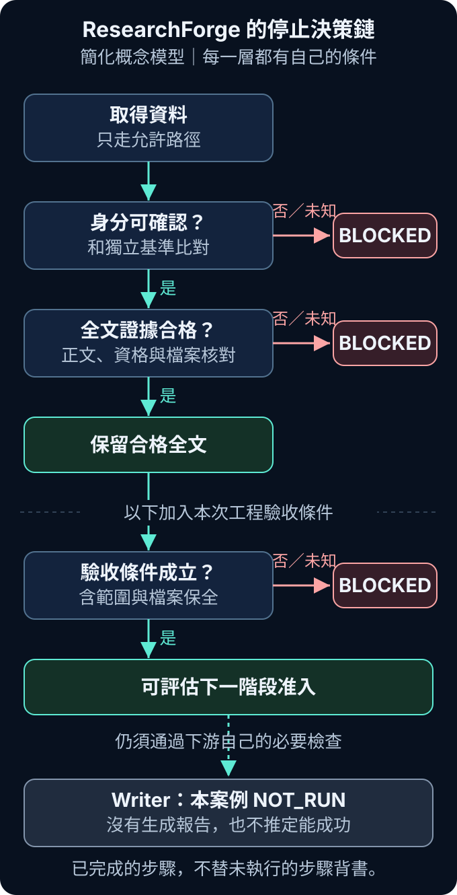

# Day 02｜為什麼我讓 AI 在證據不足時停下來？

上一篇，我回看 ResearchForge 最早的報告生成器：畫面出現「完成」，觸發它的卻可能只是計時器。介面確實完成了切換，研究工作並沒有因此完成。這讓我開始追問，完成提示背後究竟有什麼證據。[1]

原先預告要接著拆模板與匯出；今天先把這個問題往前推一步，轉看截至 2026 年 8 月 31 日能核對的近期驗證紀錄。以下不是最初版本就有的能力，也不是把後來的設計搬回早期歷史。

如果系統不能證明自己已經做對，下一步該怎麼辦？我現在給的答案是：先留下缺口，不要讓下一段流程替它假設成功。

## 「還不知道」不能直接填成「通過」

想像一條很直覺的 AI 流程：輸入題目、呼叫模型、得到結果。中間只要沒有拋出錯誤，畫面就能顯示完成。但研究工具多了一個責任：輸出的內容根據什麼？

找到論文標題，只能說找到一筆資料；取得摘要，不能說已讀全文。即使下載成功，也還要確認拿到的是哪篇文章，以及檔案裡是否真的有研究正文。

我把「已經證明不符合」和「還不能判斷」分開。前者像是目標與文件的 DOI 明確衝突；DOI 是辨認學術文獻的持久識別碼。後者則可能是目標資料本來就太少，無法完成比對。兩種情況都不應放行，但需要補的東西不同。

近期就有一個較小的例子：下載端回傳 HTTP 200，甚至取得了文件內容，原本的目標卻只有截短標題與網址，缺少足以核對的書目資訊。該次紀錄留下 `UNKNOWN` 與 `CANONICAL_IDENTITY_INSUFFICIENT`，沒有把下載內容升級成合格全文。[2]

canonical identity 在這裡可以先理解成「作為比對基準的論文身分」。如果直接把待驗文件的資訊抄回基準，再宣布兩邊一致，就只是在拿它證明自己。這次缺的是獨立比對依據，不是再多寫一句「請仔細確認」。

## 不確定時，預設不要放行

這就是我在這些入口採用的 fail closed：必要條件沒有成立時，保留停止狀態。它不是遇到任何問題都結束整個產品，而是限制某一筆材料能不能往下走。

在目前的全文處理程式裡，結果先從 `BLOCKED` 開始。程式會檢查允許的取得路徑、文件身分、正文資格，以及保存下來的原始檔雜湊。雜湊像是檔案內容的指紋，用來核對前後是否仍是同一份資料。條件通過，才建立合格結果；拒絕分支則清空供下游使用的文字與片段，關閉可用於主張和報告的標記。[3]

這比只顯示一個紅色警告更具體。警告如果還附帶可直接使用的正文，下游仍可能誤把它當成材料。停止條件必須影響資料能否被使用。

下面把資料處理與這次驗收的檢查順序放在一起。這是**簡化後的概念模型**，不是 repository 中一個包辦所有階段的 production 函式：

```text
取得資料 → 確認身分 → 驗證全文 → 檢查驗收條件
                                        ↓
                              才能評估下一階段准入
```

```python
# 簡化後的概念模型；不是實際 production code
if identity != VERIFIED:
    STOP("身分尚未確認")
if full_text != QUALIFIED:
    STOP("全文證據不足")
if unexpected_state_change:
    STOP("驗收範圍需要重新確認")
if required_stage == NOT_RUN:
    ready_for_that_stage = False
```



圖中的檔案變動檢查屬於這次工程驗收；它不代表每次線上研究請求都會掃描整個 repository。Writer，也就是負責組織材料、撰寫報告的階段，仍有自己的准入要求。

## 全文真的拿到了，為什麼還是停？

最能說明這件事的，是一次近期的 HTML 全文驗證。這次不是只找到摘要：保存的原始文件有 209,155 bytes，紀錄確認了正文結構，並依既有規則通過身分比對與全文資格檢查。受控測試、相關回歸測試、型別檢查與建置也都通過。[4]

如果只看下載結果與綠色測試，這很容易被寫成「完成」。但最後封存證據時，檢查程式比對開始與結束的檔案狀態，發現本次允許範圍以外的文章檔案出現變動。因此，整體驗收留下 `BLOCKED_CONCURRENT_MODIFICATION`。[4]

這不是發現論文是假的，也不是已通過的功能測試突然失敗。原始全文與受保護證據仍然保留，相關程式也符合那些測試記錄的雜湊；沒有通過的是更外層的工作目錄保全條件。單一檢查可以是 `FAIL`，整個階段因此是 `BLOCKED`，兩者在描述不同層級。

我能從紀錄確認檔案變了，不能據此推論是誰改的，更不能稱它是惡意修改。當時的停止規則要求先釐清範圍，沒有授權把未知變動算進自己的成果，也沒有把那些檔案還原來製造乾淨現場。

這個案例讓我把「拿到有效材料」與「可以替整輪驗收背書」分開。前者的成功值得保留；後者缺少的條件，也不能被前者抵銷。

## READY、BLOCKED、NOT_RUN，要連著範圍讀

以下是從現有階段報告與結果整理的讀法，不是宣稱程式共用一個只有三種值的狀態欄位。[2][4][5]

| 狀態 | 我可以據此說什麼？ | 不可以偷渡的結論 |
|---|---|---|
| `READY` | 指定範圍的必要條件已獲支持 | 整個產品都已完成 |
| `BLOCKED` | 某個前提或驗收條件未滿足，不能繼續放行 | 每個已執行步驟都失敗 |
| `NOT_RUN` | 這個步驟沒有執行 | 它已成功，或它已失敗 |

例如，獨立書目身分的恢復可以在它自己的範圍內 READY，全文處理卻仍是 NOT_RUN。回到剛才的主案例，全文已合格，整體驗收仍然 BLOCKED。這些不是互相矛盾，而是回答不同問題。

同樣地，那次 live 全文工作沒有呼叫 Writer，也沒有生成報告。這是實際執行範圍；既有回歸測試裡的模擬 Writer 測試，不等於真的寫過一份報告。單一 HTML 案例也沒有證明其他題目、來源或 PDF 都能通過。[4]

## 多跑幾次，補得上缺少的證據嗎？

網路暫時逾時，在允許的預算內重試，可能取得原本沒收到的回應。但身分資訊不足時，重複下載同一份文件，不一定增加獨立證據；工作目錄出現未知變動時，多跑一次綠色測試，也不能說明上一次變動的來源。

因此，我會先問重試預期補上什麼。缺書目比對依據，就補有來源的身分資訊；驗收邊界不清，就先確認變動範圍。這是從案例整理的處理原則，不是宣稱系統已能自動解決每一類阻塞。

這樣會變慢嗎？會增加檢查與釐清工作的成本，但這裡沒有足以量化延遲的比較實驗。我願意保留這個成本，因為缺口一旦被寫成流暢正文，讀者更難知道哪一步其實沒做。

今天留下的原則是：**無法證明，就不要往下假設。** 我不是要求 AI 永遠成功，而是讓它在缺少必要依據時，不能把「還不知道」悄悄改成「已完成」。

下一篇會接回既有 Day 03 的來源與引用基礎：來源如何被辨認和保存，以及為什麼句尾有引用，仍不代表那句話獲得支持。停止條件告訴我材料何時不能用，接著要追的，是材料究竟支持了什麼。

## 參考資料

1. 本系列 Day 01〈從報告生成器開始：成品出現了，研究還沒有〉及初始版本原始碼；用於承接介面狀態與研究能力的差別。
2. 專案 2026-08-30 的 live 身分與全文驗證紀錄，以及身分不足、下載頁不算全文的受控測試；實際取得內容與可准入材料分開記錄。
3. 專案全文處理入口原始碼；本文描述本地工作目錄中的實作，沒有宣稱部署或正式服務驗收。
4. 專案 2026-08-30 的全文驗證、測試結果、Writer 呼叫紀錄與最終封存停止紀錄；本文核對保存的證據，未重新執行 live 取得或工程回歸測試。
5. 專案獨立書目身分恢復紀錄與既有 Day 03 roadmap；前者只支持身分階段結果，後者只支持下一篇的題目安排。
