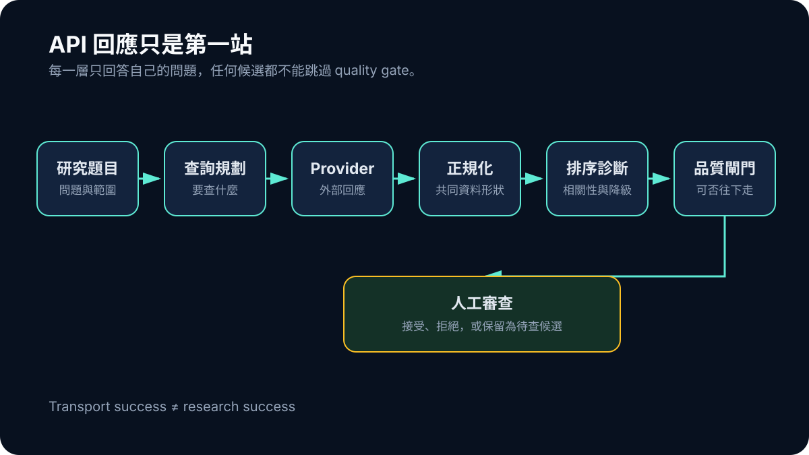

# Day 04｜搜尋開始成為一條流程：API 回應只是第一站

把一個題目送進學術搜尋 API，收到一批標題與摘要，這件事很容易被稱為「已經有搜尋功能」。ResearchForge 在 2026 年 6 月真正碰到的問題卻是：API 回來之後，誰負責判斷查詢有沒有走偏、外部服務是否降級、資料能否比較，以及結果是否值得交給使用者審查？

如果這些問題都塞在同一個函式裡，搜尋看起來只有成功與失敗。實際上，沒有回應、回應格式錯誤、回傳離題資料、只有低品質候選，代表的是四種不同故障。它們需要的修復也不同。

## 從一次呼叫拆成可診斷的階段

當時的搜尋核心開始出現明確分工：搜尋意圖先被規劃成查詢，provider configuration 決定哪些外部來源可以使用，preflight 在送出請求前檢查必要條件，回傳資料再進入 normalization、reranking 與 diagnostics。稍後加入的 relevance 與 generation readiness，則把「找到候選」和「可以往報告前進」分開。

可以把這段資料流簡化成：

```text
研究題目
→ search intent plan
→ provider retrieval
→ normalized source records
→ ranking 與 diagnostics
→ source quality gate
→ 人工審查
```



*圖：每一層只回答自己的問題；API 回應不會直接越過 quality gate。*

這不是為了把一個簡單功能畫成複雜架構，而是讓每一層回答不同問題。Planner 回答「要查什麼」；provider layer 回答「外部服務發生什麼事」；normalizer 回答「資料能否用共同格式表示」；ranking 回答「哪些候選較接近題目」；gate 則回答「目前是否值得進入下一步」。

## Provider 有回資料，不代表研究搜尋成功

最容易誤判的地方，是把 transport success 當成 research success。HTTP request 正常結束，只能證明外部服務回了某些內容。那些內容可能缺摘要，可能因查詢太泛而離題，也可能只是相關背景，不能直接回答研究問題。

反過來，一個 provider timeout 也不必讓整批候選消失。若其他來源已回傳可審查結果，系統可以保留部分資料，同時標示搜尋處於 degraded state。這比把整次工作標成單一的成功或失敗更誠實，也更容易採取下一步。

因此 diagnostics 不能只是開發者 console 裡的一段錯誤。它至少要保存失敗發生在哪個 provider、哪個 stage，以及現有候選受到什麼影響。前台不需要顯示原始錯誤堆疊，但要讓使用者知道目前結果可能不完整，而不是用一個綠色勾勾掩蓋缺口。

## Reranking 只能排序，不能替證據背書

搜尋結果很多時，reranking 很有吸引力：替標題、摘要、語言與來源訊號計分，把最像答案的項目排到前面。但一個較高的相關性分數，仍然不是研究正確性的證明。

排序適合降低人工檢查成本，不能單獨決定來源是否可用。高度相關的 review 可能適合作背景，卻不是直接研究；標題命中所有關鍵詞的文章，也可能研究了不同族群。若下游把 ranking score 當成 evidence eligibility，搜尋層就越權替研究層做了決定。

這也是為什麼當時的流程要接上 source review 與 generation readiness。候選可以被排序、解釋與標記，但仍要經過後續邊界。那時還沒有後來集中式的 evidence authority；能確定的是，搜尋結果已不再直接等於報告材料。

## 把失敗留在正確的位置

可診斷流程最大的價值，是讓團隊不必一看到報告不好，就立刻改 prompt。若 preflight 沒有帶入正確設定，修 Writer 沒用；若 query plan 已偏離題目，換 provider 只會更快取得離題結果；若 provider 回傳正常而 ranking 放錯順序，問題也不在模型寫作。

我後來會用一個簡單問題檢查搜尋架構：目前第一個無法證明正確的階段在哪裡？這比「搜尋有沒有成功」更有用。它保留了因果鏈，也避免後面的漂亮輸出替前面的失敗擦脂抹粉。

這個階段證明的是搜尋開始可測、可定位，不是所有 provider 已可靠，也不是任意題目都能找到合格證據。可診斷的候選清單仍只是入口；只有進入 review、被明確接受的材料，才應該往 Evidence Card 與報告草稿移動。
