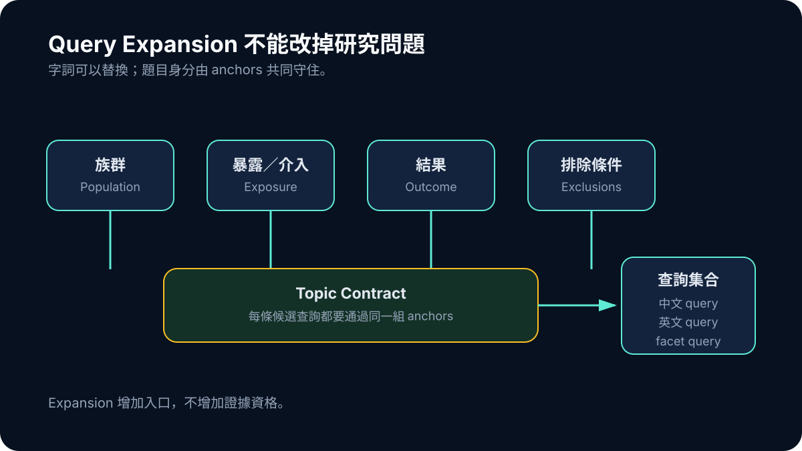

# Day 06｜搜尋題目不是一個字串：Query Expansion 如何不搜歪

Query expansion 很容易從一個單純症狀開始：搜尋結果太少。最直覺的修法，是替原題換幾個說法、加一些同義詞，再多問幾次 provider。

結果數量確實上升了，相關性卻不一定一起上升。有些查詢保留了熱門概念，卻把研究對象或 outcome 丟掉；有些英文翻譯單字都對，組合起來卻不像學術資料庫會出現的表達；還有些擴張加入太多泛稱，最後搜到一批「看起來屬於同領域」但無法回答原問題的文章。

ResearchForge 後來採取的方向是：query expansion 的目的不是產生更多句子，而是在不丟失研究意圖的前提下，增加不同檢索入口。

## 一個題目其實包含好幾種約束

以「短影音使用對高中生睡眠的影響」為例，至少有幾個不能隨便拆掉的元素：使用型態是短影音，不是所有社群媒體；族群是高中生或相近年齡的青少年；outcome 是睡眠，而不是一般心理健康；問題關心的是關聯或影響，不只是使用現況。

如果 expansion 只留下 `social media` 和 `sleep`，召回可能增加，問題卻已經變了。如果只查中文，又可能錯過大量英文 metadata；但把中文逐字翻成英文，也不代表得到研究社群慣用的詞。

ResearchForge 後來把題目拆成較明確的 planning fields：canonical topic、中文與英文 query seed、subtopics、must-include terms、exclude terms，以及 domain hints。這些欄位的價值不是讓 schema 看起來完整，而是讓每一條查詢都能被問同一個問題：你還帶著原本的研究對象、暴露、結果與範圍嗎？

## Anchor 和關鍵字的差別

我把不能在 expansion 中遺失的概念稱為 anchor。關鍵字可以替換，anchor 則是查詢身分的一部分。

例如 `high school students` 可以改成 `adolescents` 或適當年齡區間，這是字詞層的變化；但如果改成所有成人，population anchor 就消失了。`short-form video` 可以有平台或行為上的替代詞，但若擴成所有 screen time，就需要被標記成較遠的間接來源，而不能假裝是同一題。

以下是一個簡化概念，並非 production code：

```ts
type QueryPlan = {
  population: string[];
  exposure: string[];
  outcome: string[];
  exclusions: string[];
};

function admissibleQuery(query: string, plan: QueryPlan) {
  return hasAny(query, plan.population)
    && hasAny(query, plan.exposure)
    && hasAny(query, plan.outcome)
    && !hasAny(query, plan.exclusions);
}
```



*圖：字詞可以替換，但族群、暴露／介入、結果與排除條件共同守住題目身分。*

真實搜尋不會只靠字串包含判定，但這段抓住一個設計重點：expander 不應該擁有無限制改題的自由。它可以提出候選查詢，deterministic gate 仍要檢查題目完整性。

## 雙語不是把同一句翻兩次

ResearchForge 面向繁體中文使用者，但主要學術 provider 的 metadata 很多是英文。雙語搜尋因此不是裝飾，而是 recall 的基本條件。

不過，中文 query 與英文 query 不必完全對稱。中文適合保留使用者原始意圖與在地詞彙，英文則可能需要研究設計、正式 outcome 名稱或常見縮寫。真正重要的是兩組查詢最後都回到同一個 topic contract，而不是彼此獨立發散。

這也是為什麼後來的 payload 同時保存 display title、canonical topic、query seeds、subtopics、must-include、exclude 與 selected plan identity。畫面上的標題可以寫得自然，真正送進搜尋的資料則必須更精確。UI copy 和 retrieval query 不該共用同一個字串，否則只要產品為了好讀而改標題，搜尋語意也會一起漂移。

## Query Expansion 的兩種失敗

第一種失敗很明顯：太保守。查詢只有原題，provider 回來幾筆或零筆，系統沒有足夠候選來源。

第二種失敗更危險：太成功。它回來很多結果，標題也都帶有熟悉詞彙，但真正符合 population、exposure、outcome 的直接研究很少。這種結果會讓後面的 relevance scorer、人工審查甚至 Writer 承受原本應該在 planner 解決的問題。

因此，好的 expansion 不只記錄最後用了哪些 query，也要記錄每一條 query 為什麼存在、從哪個 facet 來、帶著哪些 anchor、哪個 provider 執行，以及加入後到底新增了多少非重複候選。否則系統很容易把「發出更多請求」誤當成「研究變得更完整」。

## 怎麼驗收一組 expansion 真的有幫助

只看 query 文句是否通順沒有太大意義。我更在意它對結果集合做了什麼：是否帶回去重後的新候選、是否仍通過 topic gate，以及是哪個 facet 與 provider 找到。Query lineage 讓離題結果可以追溯到 expansion、provider ranking 或 relevance gate，而不是只剩一張最終清單。

Planner 產生的詞句是檢索指令，不是 evidence；provider snippet 也不一定是原文結果。把 planning provenance 與 evidence provenance 分開，才能避免「因為搜尋了某個假設，報告裡就出現那個結論」。查詢增加也會放大 provider fan-out，因此每條 expansion 仍需有可觀察的成本與停止條件；完整的 side-effect budget 是後續才收斂的能力。

Query plan 準備好後，ResearchForge 會把它送往不只一個學術服務。問題也從「查什麼」轉成「不同服務回來的資料究竟能不能用同一種語言表示」：OpenAlex、Crossref 與 Semantic Scholar 看似都在回傳論文，三份 JSON 卻不能直接串起來就算完成。
