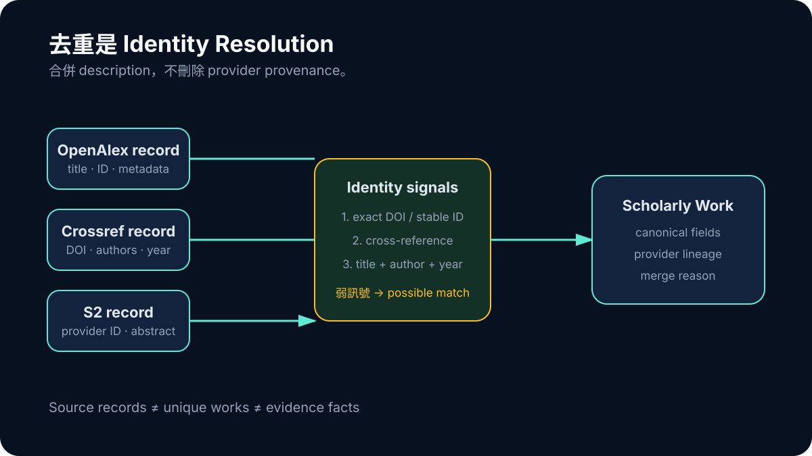

# Day 08｜DOI、作者與年份：去重其實在辨認研究

如果 OpenAlex、Crossref 和 Semantic Scholar 同時找到一篇論文，最直覺的結果是畫面多出三張來源卡。使用者可能以為自己看了三份證據，系統也可能把來源數算成三，最後 Writer 更可能把同一個發現重複寫三次。

去重看似是一個清理步驟，實際上會改變整份研究報告對證據廣度的判斷。重複沒有消掉，系統會高估 coverage；不同研究被錯誤合併，系統則會刪掉真實差異。兩邊都不是單純的 UI 小瑕疵。

## DOI 很好用，但不能把它當成世界上唯一的身分證

對有 DOI 的記錄，先做 DOI normalization 是最穩定的路徑之一。URL 前綴、`doi:` 前綴、大小寫與多餘空白，都應該收斂成同一個 canonical value。只要 exact DOI 相同，多 provider 記錄通常可以安全地被視為同一個 scholarly work 的描述。

問題是，並非每筆資料都有 DOI。Preprint、repository copy、conference item、舊資料或不完整 provider response 都可能只剩 title、authors、year 或 provider ID。此時 deduper 不能只做 `title === title`，因為標點、大小寫、斷行與副標題都會造成差異；也不能只做模糊相似度，否則像「AI in Education」這類短標題很容易把不同作品合併。

比較安全的策略是建立由強到弱的 identity signals：

```text
exact DOI / stable repository ID
→ provider cross-reference
→ normalized long title + author + year
→ title similarity（只作候選，不單獨定案）
```



*圖：強身分訊號可以合併；弱訊號只建立 possible match，不能直接刪除差異。*

訊號越弱，越應該保留不確定性。去重不是一定要產生 yes/no；它也可以回傳 possible match，交給後續規則或人工檢查。

## 合併記錄時，不能只留下「最長的那筆」

確認兩筆描述同一篇研究後，還有第二個問題：metadata 要怎麼合併？一個 provider 可能有較完整作者，另一個有 abstract，第三個有 DOI 或較好的公開連結。直接選欄位最多的記錄，可能丟掉其他來源獨有的資訊。

ResearchForge 的 normalized model 因此需要同時保留 canonical fields 與 provider IDs。合併不是刪除來源，而是把多份描述掛到同一個工作身分下。未來若 abstract 衝突、年份不同或 URL 失效，系統仍知道各值來自哪裡。

這個設計後來在全文取得階段還會再分裂一次：同一個 study 可以有 version of record、preprint、repository copy、HTML、JATS 或 PDF 等不同 manifestation。它們屬於同一研究，不代表每個 artifact 都能互換。Day 25 會再談這個問題；目前只要先記住，work identity 和 file identity 不是同一層。

## 去重錯誤會一路污染哪些指標

假設同一篇研究被算了三次，表面上只多兩張卡，實際影響至少有四層。

第一，來源數門檻可能被誤判。系統以為已經有足夠多 accepted sources，提早解鎖報告。第二，evidence diversity 被高估。同一個樣本與同一個結果被包裝成多個獨立發現。第三，相關性或權威排序可能被投票效應放大。第四，Writer 在看到重複材料時，容易把同一結論寫成「多項研究一致指出」。

反過來，如果 deduper 把兩篇相似標題的研究合併，系統可能錯過不同 population、方法或結果方向，最後把真正的 heterogeneity 消掉。

因此 dedupe 應該發生得早，但不能沒有 audit。至少要能回答：哪些記錄被合併、依據什麼 identity、保留了哪些 provider provenance、是否存在弱匹配。

## Source count 不是 study count，更不是 evidence count

這裡還有一個很容易混淆的名詞問題。搜尋結果中的 source record 可能是研究、review、書籍章節、網頁或 metadata description；同一研究又可能有多個 record；一篇研究則可能提供多個可用事實。於是：

```text
raw records ≠ unique works ≠ direct studies ≠ evidence facts
```

如果 dashboard 只顯示「找到許多筆」，使用者很難知道那個數字在哪一層。ResearchForge 後來會把 candidate、direct study、payload 與 qualifying artifact 分開計數，就是因為早期 source count 太容易被誤讀。

這也解釋了為什麼「我們接了三個 provider」不是品質結論。Provider 增加 raw records；identity layer 才決定 unique works；relevance 與 study-type layer 決定哪些真的回答問題；full-text 和 fact extraction 再決定能形成什麼主張。

## 去重要怎麼測，才不會只測到 happy path

Exact DOI 相同的正例很容易寫，真正容易出錯的是邊界。測試應同時包含「非常像但不能合併」與「看起來不同卻應合併」的案例。弱匹配不能覆蓋強身分；若規則無法確定，保留兩筆 possible matches 通常比不可逆錯合安全。

早期 dedupe 形成的是 work-level identity，不代表 evidence admission。多個 provider badge 也只表示多條發現路徑，不是多份獨立研究支持。把入口多樣性與證據多樣性分開，報告才不會把資料庫覆蓋率寫成研究一致性。

## 去重其實是在建立後續真實性的座標

很多資料管線把 dedupe 放在最後，當成報表美化。對 evidence system 而言，它應該更接近前段的 identity foundation。只有先知道「這是同一篇還是兩篇」，後面才能討論引用、比較、矛盾與來源多樣性。

實作上不需要一開始就發明完美的全球 scholarly identity。可以先採強訊號合併、弱訊號保留候選，並把 merge reason 存下來。最重要的是不要把模糊推測包裝成確定，也不要讓下游偷偷用另一套規則重新合併。

來源去重後，清單終於比較接近真實。但「不重複」仍不保證「回答了問題」。搜尋結果可能每個字都很熟悉，整篇研究卻錯了族群、暴露或 outcome；identity 解決之後，relevance 才真正有可比較的對象。
