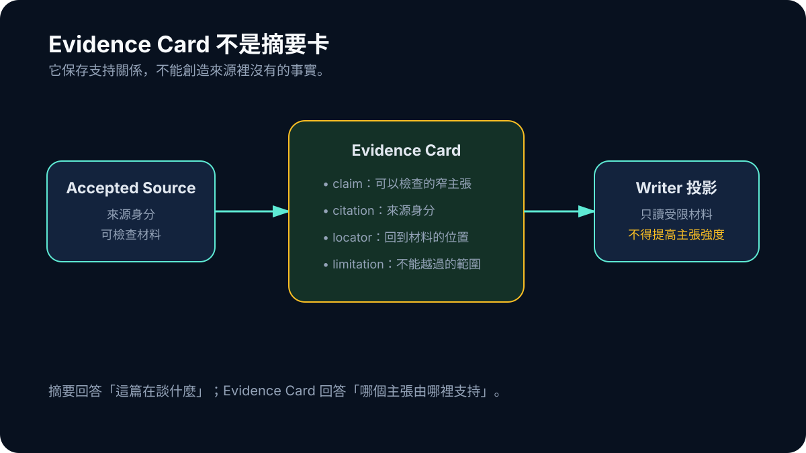

# Day 10｜從摘要到可主張證據：Evidence Card 的真正工作

一篇論文摘要可以讓人快速知道研究大意，卻不一定能告訴系統「正文現在可以寫哪一句話」。這兩種用途很接近，所以我早期很容易把 Evidence Card 做成精簡版摘要：研究在談什麼、可能有哪些重點、適合放進哪個章節。

這樣的卡片對閱讀有幫助，對證據治理卻不夠。因為「這篇大概在說什麼」和「這個具體主張由哪段材料支持」之間，還隔著研究設計、族群、比較組、outcome、效果方向、數值、限制與 locator。

Evidence Card 真正要承擔的，不是把論文變短，而是把來源轉成下游可以安全使用的最小合約。

## Summary 回答主題，Evidence 回答支持關係

假設摘要寫著某種使用行為與睡眠品質相關。Summary 可以重述這個結論；Evidence Card 還要問：研究的是哪個年齡層？使用行為如何測量？睡眠是自陳還是裝置紀錄？結果只是相關，還是有介入設計？效果方向在哪一段？是否有可追溯數值？

如果這些欄位沒有取得，卡片應該保存缺口，而不是讓 summarizer 用常見研究形式補齊。

後來的 ResearchForge 會讓 evidence card 連到更完整的 structured facts、safety state 與 provenance。早期版本沒有一次擁有所有欄位；把現在的完整結構倒推成 6 月就已存在，反而會失去真正的學習過程。

## 一張可用卡片，至少要能回答四件事

第一，**誰說的**。Card 必須回到唯一來源身分，而不是只保存一段無主文字。第二，**說了什麼**。主張要比整篇摘要窄，能被驗證。第三，**在哪裡說的**。至少要有 section、span、page 或可重建 locator。第四，**允許怎麼說**。相關性研究不能被 Writer 改成因果，abstract-only 不能被描述為全文方法分析。

可以把概念簡化成：

```ts
type EvidenceCard = {
  claim: string;
  sourceId: string;
  citation: string;
  reviewState: "ACCEPTED" | "REJECTED";
  locator?: { section?: string; page?: number };
};
```

這不是 production type，但它顯示 Evidence Card 和摘要卡的根本差別：摘要卡以閱讀為中心；Evidence Card 以 claim 與來源之間的可追溯關係為中心。



*圖：Card 不創造事實；它只把已接受來源中的主張、引用、位置與限制一起交給下游。*

## Locator 與限制不能在傳遞時消失

一段可引用重點如果離開來源後只剩文字，Writer 就無法知道它來自摘要、正文哪一節，或只是卡片產生器的重述。早期 card contract 因此至少需要讓 claim、citation identity 與可用定位一起移動；取不到的欄位也不應由 summarizer 補齊。

後來系統才進一步把 `UNKNOWN` 與 `NOT_REPORTED` 做成明確狀態。這裡要保留的歷史界線是：早期 Evidence Card 建立了 transport layer，卻還不是完整的 study-level fact record。

## Card 數量也會騙人

一篇來源可以產生很多卡，但卡多不代表證據廣。若十張卡都從同一段摘要換句話說，系統可能誤判 evidence density；若卡片沒有 claim identity，Writer 也可能把相似內容寫成多個獨立發現。

後來的 long-report gate 就碰到這個問題。大量 raw prose 經過 validation、repair 與 canonicalization 後，真正能安全保留的內容遠少於表面字數。系統最後選擇承認材料只夠形成較短的有限報告，而不是用重複、轉折與泛化語句湊到目標長度。

這提醒我，Evidence Card 的品質應該看 unique claim concepts、來源多樣性、provenance 完整度與研究差異覆蓋，不是只看 card count。

## Evidence Card 不應該決定最終真相

卡片是重要中間層，但它不該成為又一個各自為政的 authority。早期系統在 card、report readiness 與 Writer 間仍可能重複解讀資料；後來的 owner 與 revision 概念是對這個缺口的回應，不能回寫成 6 月已完成。

在這個早期階段，能建立的安全原則是：Evidence Card 負責傳遞來源、claim 與限制，不自行提高證據資格。給人看的摘要與給 Writer 的窄投影可以不同，卻都不能把原始 provider payload 當成未受限內容。

## 對其他 RAG 或 agent 系統的提醒

很多 RAG 系統把 chunk 當成 evidence。Chunk 只是文字切片；除非它同時帶有來源身分、位置、資料狀態、適用範圍與可允許主張，否則下游仍然要臨場猜測。

建立 Evidence Card 的目的，不是讓 prompt 更長，而是讓 prompt 更窄、更可驗證。它把「可以拿來參考的文字」轉成「可以在特定條件下支持某類句子的材料」。這個差別會直接影響 hallucination、citation correctness 與後續除錯能力。

從題目走到一張張 Evidence Card 之後，問題不再只是單篇來源是否可讀，而是整個 research question 的不同部分有沒有被覆蓋。很多卡片若都堆在同一個角落，仍然不會自然形成一個答案；那需要的是以問題為中心的 synthesis，而不是來源順序的接龍。
