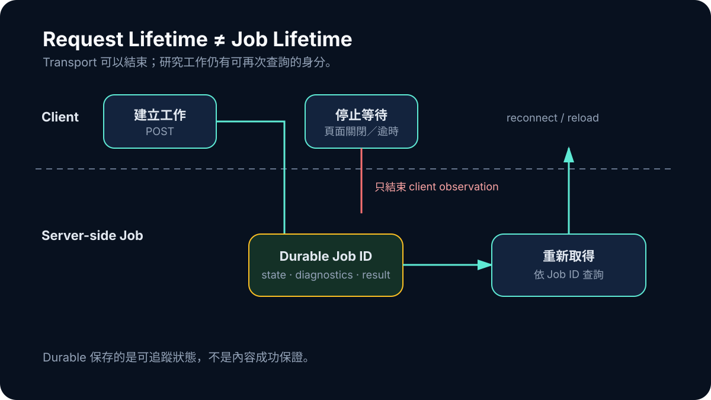

# Day 13｜瀏覽器關掉，研究工作還在嗎？

短 API request 很容易理解：送出請求，等待回應，逾時就失敗。研究工作不是這麼短。它可能要規劃查詢、呼叫多個來源、整理結果，再產生可檢查材料。如果瀏覽器是唯一等待者，頁面一關，系統就很難回答最基本的問題：工作尚在執行，還是已經失敗？

2026 年 7 月的 durable grounding job，把這兩種生命週期第一次拆開。Client request 可以結束；research job 仍由持久化的 identity 與 repository state 表示。這不是單純把 timeout 調長，而是重新決定誰擁有工作的真相。

## Request ID 不等於 Job ID

一次 HTTP request 的身分通常只服務 transport。它被取消或連線中斷後，對伺服器端長任務沒有足夠語義。Job ID 則應代表一個可再次查詢的研究工作，並連到狀態、診斷與結果。

簡化後的流程是：

```text
client 建立工作
→ server 建立 durable job identity
→ background stages 更新狀態
→ client 依 job identity 重新取得結果
```



*圖：client 可以停止等待或重新連線；job identity 與持久化狀態仍由 server-side repository 保存。*

這裡最重要的轉變，是 client 不再擁有唯一狀態。重新整理頁面不該創造一個全新研究世界，也不該把前一個仍在進行的工作誤判成零結果。

## Persistence 保存的是語義，不只是 JSON

把 job 存進資料庫並不自動得到 durable system。真正要保存的是哪些狀態可以轉移、哪些結果已經完成，以及重試時能否安全延續。

例如，若搜尋已經完成、證據整理尚未開始，resume 應從 checkpoint 繼續，而不是重新呼叫所有 provider。若 job 已經走到終止狀態，下游也不應因另一個 client request 再次改寫 verdict。這些規則需要明確 contract，否則 persistence 只會把混亂保存得更久。

當時的 committed implementation 已有 durable repository、routes、shared contracts 與 tests。隔天的 reload recovery 修復存在於另一條 branch 證據中，不能假裝已經合併進目前 HEAD。這個差別看似是 Git 細節，實際上正符合整個系列的原則：存在過、被驗證過與已進入當前主線，是三種狀態。

## Client timeout 只描述 client

現在回頭看，這個階段最重要的語意是：client 停止等待，只能證明 client 沒有繼續觀察。它不能證明 server job 失敗，更不能把尚未取得的 evidence count 改成零。

2026 年 7 月時，後來那套完整的 terminal manifest、revision 與 timeout 分類還不存在，所以不能把它們倒灌成早期能力。但 durable job 已經建立必要前提：研究工作有一個不依賴單一瀏覽器頁面的 owner。

這個設計也改善錯誤訊息。以前 UI 只能說「請求失敗」；有了 job identity 後，系統至少能區分「目前無法取得最新狀態」與「工作已明確進入失敗狀態」。前者是 observation 問題，後者才是 business state。

## Durable 不等於永遠成功

持久化常被誤解成可靠性保證。Job 能在 client 離開後繼續存在，只表示 lifecycle 更可追蹤，不表示 provider 一定成功、證據一定足夠或報告一定能匯出。它解決的是「工作發生過什麼能否被保存」，不是「工作結果是否合格」。

這個區分對任何 agent workflow 都重要。長任務應把狀態放在可查詢的工作實體裡；transport retry 不能默默重做昂貴副作用；未知下游結果要保持未知。若把 durable job 當成 success badge，只是把另一個概念混在一起。

Durable job 解決了工作身分，沒有替內容取得資格。ResearchForge 在同一時期加入 direct paper search，讓找單篇論文變得更直接；但一篇 paper 出現在搜尋畫面上，和它足以支撐研究報告，仍然相隔好幾道門。
