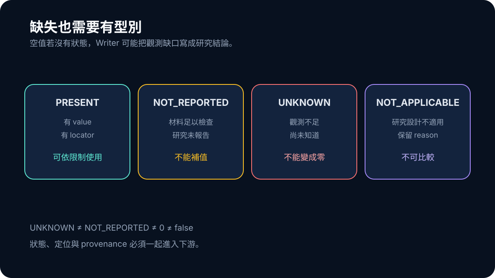

# Day 21｜先把 Study Facts 變成可拒絕的資料

「研究沒有報告樣本數」和「系統沒有取得能看到樣本數的內容」看起來都像空白，但它們代表完全不同的知識狀態。前者是在足夠材料中確認未報告；後者只是觀測不足。若兩者都存成 `null`，Writer 很容易把系統不知道的事，改寫成研究沒有發生的事。

Study Facts V2 的核心不是增加更多欄位，而是讓缺失也有型別。研究設計、族群、暴露或介入、比較組、outcome、方向、數值與 locator 都需要同時保存 value、status 與 provenance。

## UNKNOWN 不能被轉成零

這個規則看似基本，實際上很容易在資料管線裡被破壞。Parser 找不到欄位，程式用預設值補零；aggregator 把缺值當 false；Writer 又把 false 寫成「研究未發現效果」。只需幾次便利轉換，觀測缺口就變成了研究結論。

V2 因此區分 `PRESENT`、`NOT_REPORTED`、`UNKNOWN` 與 `NOT_APPLICABLE`。`PRESENT` 表示有可定位內容；`NOT_REPORTED` 需要足夠材料支持「已檢查但未報告」；`UNKNOWN` 保留取得或辨識不足；`NOT_APPLICABLE` 則表示這個欄位對該研究設計不成立。

```ts
type FactState<T> =
  | { status: "PRESENT"; value: T; locator: string }
  | { status: "NOT_REPORTED"; locator: string }
  | { status: "UNKNOWN"; reason: string }
  | { status: "NOT_APPLICABLE"; reason: string };
```



*圖：只有 PRESENT 帶有可使用的值；其他狀態保存不同原因，不能被折疊成零或 false。*

這只是概念示意。真正重要的是，下游不能只拿 `value` 而忽略 status。

## Locator 讓事實能被重新檢查

一個數字若沒有 locator，只能說 parser 曾經產生它，不能說 reviewer 能回到來源驗證。Study Fact 因此要保存 exact span、section、page 或可重建位置，以及它來自哪一種內容層級。

同一篇研究若先只有 abstract、後來取得全文，新的 fact 不能悄悄覆蓋舊狀態。Evidence revision 應該改變，讓 downstream 知道哪些結論需要重新評估。這也是 provenance 不只是參考資料連結的原因：它描述這個值在什麼觀測條件下成立。

## 7/10 LIMITED 仍然不是 FORMAL

8 月 26 日的 fresh ten-topic extraction 達到 7/10 LIMITED、0/10 FORMAL，Writer requests 仍為零。這個結果比前一輪 0/10 publishable 更接近可用事實，卻沒有跨過正式門檻。

LIMITED 的 cases 可以保留局部、有明確限制的 facts；它們不能因為數量看起來接近完成，就被描述成七份正式報告。Frozen replay 從既有材料恢復的數值也必須和 fresh current-live 分開，因為 replay 證明 contract 能處理已知輸入，不證明當下 acquisition 能重新取得同樣材料。

## 可拒絕的 schema 才能保護 Writer

許多 schema 只檢查欄位型別，資料缺了就允許 optional。Study Facts 還要檢查 epistemic eligibility：這個值是從哪裡來、是否適用、能支持多強的主張。若缺少 locator 或研究型態無法辨認，准入層應有理由拒絕，而不是把負擔交給 Writer。

這個設計讓 failure 變得可行動。系統不只說「資料不足」，還能指出缺 comparator、outcome definition、結果方向或可追溯數值。當缺口有了型別，補查才可能針對缺掉的 evidence 格子，而不是無限重搜整個題目。
