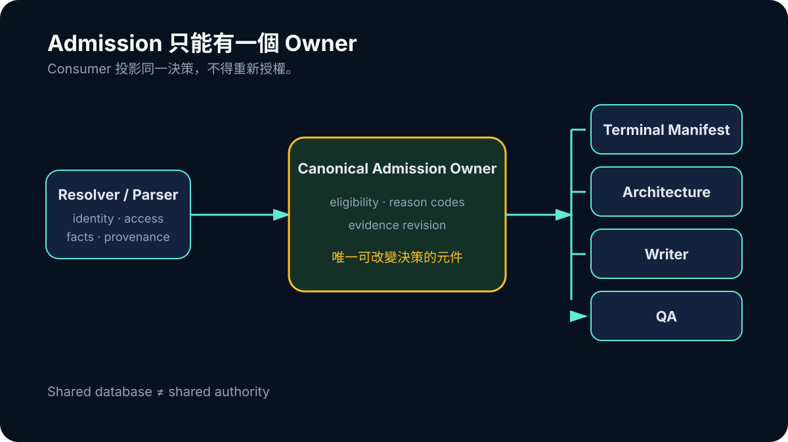

# Day 24｜同一研究只能有一個 Admission Owner

Durable job 解決了工作「有沒有結束」，卻沒有自動解決證據「能不能用」。當 Terminal Manifest、formal architecture、Writer 與 QA 各自根據手上的 source record 重新計算 eligibility，同一篇研究可能在一處是 LIMITED，在另一處被當成 FORMAL，到了 Writer 又換成 fallback record。

這就是 split-brain truth。資料都存在，模組也都按照自己的規則工作，整體卻同時擁有多個互相矛盾的答案。

## Canonical Owner 不是一張總表

把所有資料放進同一個 database，不代表 authority 已集中。真正的 owner 是唯一可以改變 admission decision 的元件；其他 consumer 只能投影它的結果，不能讀幾個欄位後再做自己的判定。

Observed worktree 中的 canonical study admission，把幾類訊息綁在同一個 typed result：job 與 workflow identity、study identity、access state、parser 與 Study Facts readiness、provenance、admission class、reason codes 與 evidence revision。

```text
resolver / parser
→ canonical access state
→ canonical study admission
→ manifest / architecture / Writer / QA projections
```



*圖：只有 canonical owner 能改變 evidence eligibility；Manifest、Architecture、Writer 與 QA 只能投影同一個 revision。*

當 upstream decision 改變，revision 也必須改變；consumer 若拿到 mixed revision 或 admitted 與 BLOCKED 混合集合，就應 replan，而不是自行修補。

## FORMAL、LIMITED、BLOCKED 是權限，不是評分

一個抽象 confidence score 很難告訴 Writer 可以說什麼。Admission class 則要連到具體 permission：FORMAL 允許哪些正式主張；LIMITED 必須保留哪些限制；BLOCKED 完全不能進 Writer；UNKNOWN 不得被消費端猜成任何一類。

這種 permission model 也防止局部「好心修復」。Writer 看見 abstract 很有用，不能自行把 BLOCKED 改成 LIMITED；QA 看見 artifact 存在，也不能忽略 owner 的 access 或 fact state。

## Substrate READY 不等於內容 READY

Canonical admission QA 記錄了 46 個 study decisions，Terminal、Architecture 與 Writer projections 沒有 mismatch。Decision totals 是 25 LIMITED、21 BLOCKED、0 FORMAL。這證明 substrate 在該次 run 中成功收斂 authority；最終 Writer-validated／publishable LIMITED-or-better 仍只有 1/10，FORMAL 仍為 0/10。

兩個結果必須一起說。Zero projection mismatch 是 control correctness；content generalization false 是材料結果。若只保留前者，就會把「大家對失敗看法一致」誤寫成「內容已成功」。

## 這是 Post-HEAD 證據

Canonical owner 存在於目前觀察到的 worktree 與 dated QA，不是 8 月 13 日 HEAD 裡已提交的能力。文章可以描述它在 8 月 28 日的工程狀態，不能把它寫回 6 月的 accepted-source flow，也不能暗示已部署。

Authority 收斂後，最大的 blocker 反而更清楚：許多研究沒有可被准入的全文 artifact。DOI metadata resolve、HTTP 200、取得 bytes、parser output 與 qualifying full text 必須被拆成不同狀態，否則 owner 只會一致地投影一個錯誤成功。
