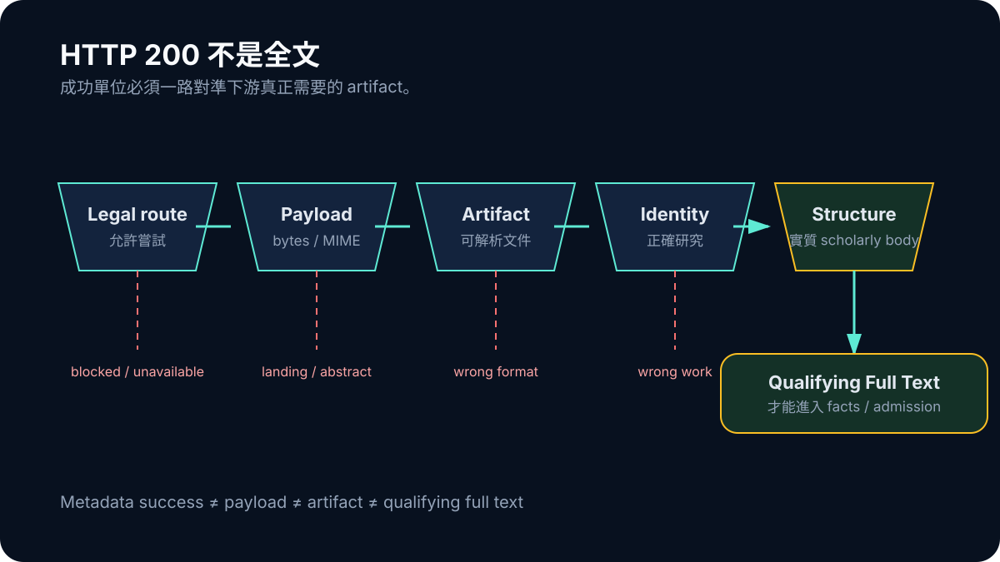

# Day 25｜HTTP 200 不是全文：從回應成功到可用 Artifact

在一般 API 整合中，HTTP 200 常被視為成功。對全文 acquisition，它只表示 server 正常回應。回來的內容可能是 landing page、只有摘要的 HTML、錯誤文章、掃描 PDF，甚至一個副檔名像 PDF、內容其實是網頁的 payload。

ResearchForge 的 full-text recovery 因此把 metadata resolution、payload fetch、materialization、identity verification、structure qualification 與 canonical admission 拆開。只有一路產生 identity-matched、可解析且有實質正文的 artifact，才有資格被稱為 qualifying full text。

## DOI 是身分線索，不是文件

DOI 很適合辨識 scholarly work，也能帶領系統找到可能 route。它本身不包含全文，更不保證 resolver 最後指向可合法取得的內容。

同樣地，Open Access metadata 只能說可能存在合法路徑，不能證明這次 fetch 已取得該研究。把 `resolved: true` 和 `artifactCreated: true` 混成一個欄位，就會讓 metadata success 穿上全文的外衣。

```ts
type AcquisitionState = {
  routeResolved: boolean;
  payloadFetched: boolean;
  artifactCreated: boolean;
  identityMatched: boolean;
  structurallyQualified: boolean;
};
```

產品真正要消費的是後面幾個狀態，不是第一個布林值。



*圖：每一層都可能停止；只有通過 payload、artifact、identity 與 structure 檢查的內容才進入 qualifying full text。*

## 先 Sniff Payload，再相信副檔名

Route 的 URL 或 `Content-Type` 都可能不可靠。系統需要檢查 magic bytes、MIME、HTML structure，再分派給 JATS、HTML、PDF 或 OCR parser。每種 parser 都只能證明格式可處理，仍要驗證內容是否為目標研究。

一份可打開的 PDF 可能是 supplement；HTML 可以是期刊 landing；OCR 成功也可能只恢復目錄或掃描品質不足的片段。若 qualification 只看字元數，長 landing page 甚至可能比短研究正文更容易誤過關。

所以 structure check 要找 scholarly body，而 identity check 要把題名、作者、DOI 或穩定 repository identity 與目標 work 對上。任何一關不成立，都應保留具體 non-qualifying reason。

## 2/10 是內容邊界，不是 Prompt 問題

8 月 28 日的 fresh current-live recovery 只有 2/10 cases 取得 qualifying full text，低於當時設定的 readiness threshold。HTTP success 或 metadata result 都沒有被算進這個數字。

這個結果指出 first weak layer 在 acquisition／qualification，不在 Writer。沒有足夠 artifact 時，重跑 prompt 只會重新整理摘要或 metadata；它不會創造研究方法、完整結果與 exact locator。

2/10 也不能被寫成系統永遠只有兩成能力。它只屬於那個固定 cohort 與時間。真正可移植的結論是 success metric 必須對準 downstream 需要的 artifact。

## Qualification 越嚴格，數字可能先變差

早期 pipeline 若把 landing、abstract shell 或錯文章算成功，表面 coverage 會較高。加入 format、identity 與 structure 檢查後，數字下降不一定是系統退化，也可能是 false positive 被移除。

這種「先變難看」是可信資料管線常見的階段。不能為了恢復舊成功率就放寬 gate；應該針對可證明的 false negative 做窄修復。

合法 Open Access materialization 仍要面對同一條界線：route 合法，payload 也可能只是 landing page。真正的修復必須同時尊重權利、格式、身分與結構，而不是找到另一條繞過限制的下載方式。
