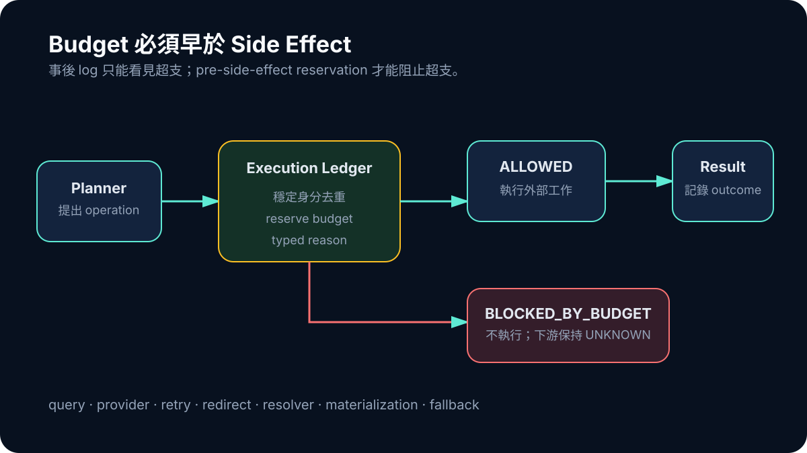

# Day 29｜Retry 不是免費的：Execution Budget 必須管到 Side Effect

在簡單搜尋功能裡，budget 看起來像兩個設定：最多幾條 query、最多幾個 provider。Agent workflow 進入 expansion、retry、redirect、resolver、fallback 與 materialization 後，這兩個數字不再代表實際外部工作。

前一天的 audit 已經看見名義計畫與 22 queries、6 providers、90 attempt rows 之間的落差。V5 的修復不是再加一個 planner limit，而是建立 authoritative execution ledger：每一次外部 side effect 發生前，都要先 reserve 對應預算。

## 預算要覆蓋真正會花成本的動作

若只計算最初 queries，retry 就是免費的；若只計 provider 數，provider-query pair 可以無限增加；若 fetch 計數但 resolver 與 redirect 不計，它們又成為隱藏路徑。

因此 ledger 需要分別記錄 query、expanded query、provider、provider-query pair、request、retry、redirect、resolver、materialization、fallback 與 elapsed time。分類不是為了做巨大的 dashboard，而是讓停止條件有一致 owner。

```ts
const reservation = budget.reserve(operation);
if (!reservation.allowed) {
  return { status: "BLOCKED_BY_BUDGET", reason: reservation.reason };
}
return performSideEffect(operation);
```

關鍵是 reserve 發生在 side effect 之前。事後才記 log，只能審計超支，不能阻止超支。



*圖：Planner 可以提出 operation；authoritative ledger 在外部工作發生前負責去重、預留、允許或阻擋。*

## Deduplication 也是 Budget 行為

同一個 operation 可能因 alias、resume 或不同 consumer 重複提出。Ledger 要以穩定 identity 去重，讓同一副作用不會被算成新的合法嘗試。這同時保護成本與可重播性。

超限也應有 typed state。`BLOCKED_BY_BUDGET` 不等於 provider failure，更不等於沒有研究證據。它說明系統選擇停止外部工作；未取得的 downstream count 仍應保持 UNKNOWN。

## Control Plane 可以 READY，Content 仍不 READY

V5 audit 在 canonical binding、budget overrun 與 hidden attempt 上都得到零 mismatch。這代表控制面在那次定義範圍內閉合。

同一個 fresh cohort 的內容結果卻是 1/10 canonical direct-study coverage、0/10 qualifying full text、零 Writer requests。數字比前一個 direct-study V3 run 更差，不能用舊 cohort 的 9/10 來補。不同 run、不同 architecture state 的結果不能拼成一個虛構成功。

這也說明 control correctness 的價值：它讓低內容結果變得可信。系統真的遵守預算、沒有偷跑 attempts、沒有跨 consumer 改寫 admission；在這個前提下，0/10 才能明確指向 lawful live coverage，而不是 instrumentation 漏洞。

## Budget 也是安全與治理

Execution budget 不只控制帳單。它限制對外部服務的壓力，建立 retry 停止點，保護 idempotency，也讓 reviewer 能重播「為什麼在這裡停止」。對會使用工具的 agent，這是一種權限模型：模型可以提出 operation，ledger 決定是否允許執行。

V5 沒有讓 ResearchForge 泛化成功。它把系統說「我試過哪些路徑、在哪裡停止」的能力變得更可靠。走到系列終點，controlled materialization 可以通過，live canary 仍不可用；真正成熟的結論不是假裝完成，而是讓 UNKNOWN 成為有 provenance、有下一步的一級輸出。
