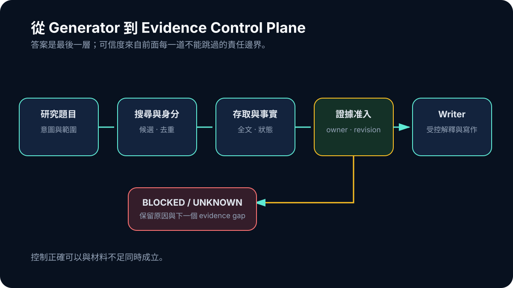

# Day 30｜讓「不知道」成為一級輸出

三十天前，ResearchForge 的問題看起來是如何產生一份報告。走到最後，最重要的產物反而不一定是長篇文件，而可能是一個清楚的 BLOCKED 結果：系統知道第一個 evidence gap 在哪裡、哪些材料已經驗證、哪些仍是 UNKNOWN，也知道自己沒有資格把缺口寫成答案。

這不是一個戲劇性的完成線。8 月 29 日的 evidence 顯示，V5 control plane 在定義範圍內通過，fresh cohort 的 qualifying full text 仍是 0/10。V6A 的 18/18 controlled materialization cases 通過，但 live canary 在當時環境不可用，沒有 current identity-matched qualifying artifact 可以綁定。Generalization 因此沒有 READY。

## 從 Generator 到 Evidence Control Plane

回看整條演化，系統每解開一個問題，就暴露更前面的限制：

```text
能生成文字
→ 文字需要來源
→ 來源需要審查與去重
→ Evidence Card 需要 synthesis
→ Writer 需要驗證與出版 gate
→ Golden case 需要泛化測試
→ Generalization 需要 Study Facts 與全文
→ 全文需要合法 route、identity 與 materialization
→ 多 consumer 需要 canonical owner
→ 多重工具呼叫需要 authoritative budget
```



*圖：每一次演化都把權限往材料與狀態靠近；Writer 留在最後，不能跳過任何上游邊界。*

這不是事先畫好的成熟藍圖。早期階段並不知道後來的 terminology，也不能因為現在看得清楚，就把 canonical admission、Study Facts V2 或 V5 ledger 寫回 6 月。

## UNKNOWN 是觀測狀態，不是空白

可靠系統至少要區分幾種「沒有答案」：研究沒有報告、系統沒有取得內容、合法路徑被阻擋、payload identity 不吻合、facts 不足以准入，以及 execution budget 已耗盡。它們都可能讓 Writer 停止，下一步卻完全不同。

`UNKNOWN` 的價值，是保留還需要什麼觀測。Live canary unavailable 不等於 canary failure，也不等於 qualifying artifact 為零；它表示這次 bounded attempt 無法建立 current evidence。只有新的、被授權的 live admission 與完整 provenance，才能改變這個狀態。

## Controlled PASS 不能替 Live 背書

V6A 的 controlled matrix 證明 materializer 在 18 個預設案例上能維持 format、identity、admission 與 provenance boundary。它不能證明當下網路 route 可用，也不能證明 arbitrary topics 都能取得全文。

同樣地，V5 的 zero canonical mismatch 與 zero hidden attempts 證明 control plane 一致，不會替內容補上任何 paper。這兩種「控制正確、材料不足」可以同時成立，而且必須同時公開。

## Fail Closed 不是消極拒絕

若 BLOCKED 只顯示一個紅色錯誤，使用者無法前進。更好的產品輸出應包含可公開的 reason class：目前缺 direct study、qualifying full text、exact locator、可比較 facts，或需要等待新的合法取得條件。它不能曝露私人 route、內部 ID 或原始 payload，但要指出最小下一步。

這讓拒絕成為 research infrastructure 的一部分。系統不是因為不知道就沉默，而是把未知的邊界與改變條件保存下來。只有 evidence revision 真正更新，Writer 才值得重新執行；沒有新材料時反覆生成，只是在語言空間抽樣。

## 下一個問題仍在上游

ResearchForge 現在較可靠的，是 canonical truth、execution budget、合法 materialization 與 fail-closed 狀態；仍未解決的是廣泛、穩定的 live full-text coverage。下一階段應先改善 lawful route coverage、identity-safe materialization 與 structured fact extraction，再重新評估 bounded synthesis。Writer optimization 排在 evidence state 改變之後。

這個系列沒有以「系統完成」收尾，因為 frozen evidence 不支持那句話。它真正走完的是另一條路：從相信一份看起來完整的報告，到要求材料、主張、引用、權限與限制都留下可追溯痕跡。

一個可信的 research system 不必永遠回答。它必須知道何時能回答、能回答多強，以及在回答之前，還缺哪一塊不能被文字代替的證據。
